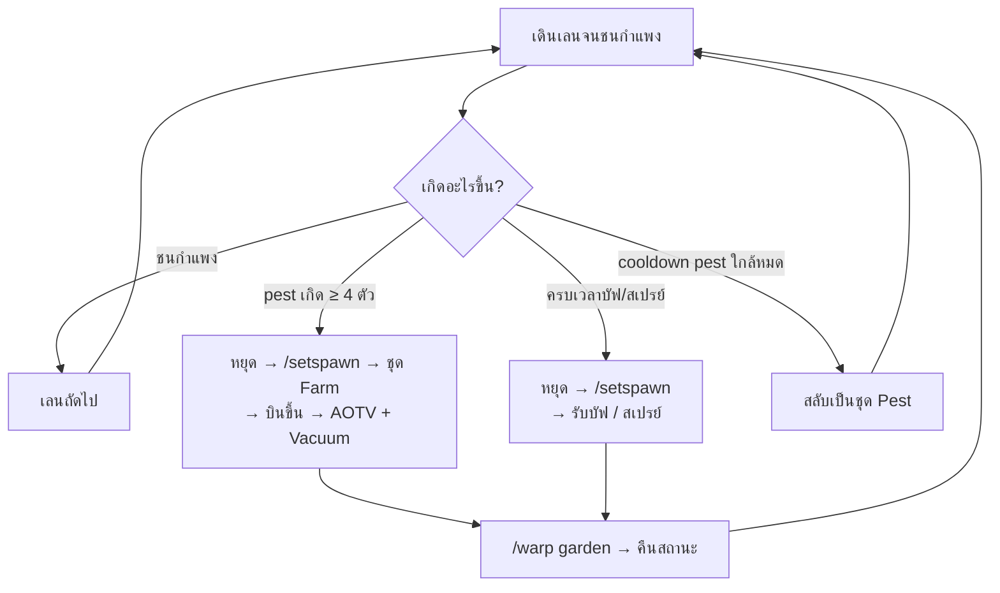

<div align="center">

# 🌾 SkyblockBot

**บอทฟาร์ม Hypixel SkyBlock Garden สำหรับ [Minescript](https://minescript.net)**

เดินฟาร์มตาม pattern · กำจัด pest ด้วย AOTV + Vacuum · รับบัฟ/สเปรย์ตามเวลา · สลับ loadout อัตโนมัติ


</div>

> [!WARNING]
> การใช้สคริปต์ automation บน Hypixel **ผิดกฎของเซิร์ฟเวอร์ และบัญชีอาจถูกแบนได้**
> โปรเจกต์นี้ทำขึ้นเพื่อศึกษาและใช้ส่วนตัว ผู้ใช้รับผิดชอบความเสี่ยงเองทั้งหมด
> โปรเจกต์นี้ไม่มีและจะไม่เพิ่มฟีเจอร์ซ่อนตัวจากการตรวจจับ

---

## 📑 สารบัญ

- [ฟีเจอร์](#-ฟีเจอร์)
- [ความต้องการ](#-ความต้องการ)
- [ติดตั้ง](#-ติดตั้ง)
- [วิธีใช้](#-วิธีใช้)
- [การทำงาน](#-การทำงาน)
- [การตั้งค่า](#%EF%B8%8F-การตั้งค่า)
- [Failsafe](#%EF%B8%8F-failsafe)
- [โครงสร้างโปรเจกต์](#-โครงสร้างโปรเจกต์)
- [ทดสอบ](#-ทดสอบ)
- [ข้อจำกัด](#-ข้อจำกัด)

---

## ✨ ฟีเจอร์

| | |
|---|---|
| 🚜 **ฟาร์มตาม pattern** | 11 profile (wheat, potato, carrot, wart, cane, cocoa, melon, pumpkin, cactus, mushroom, flower) เดินจนชนกำแพงแล้วเปลี่ยนเลน |
| 🐛 **กำจัด pest อัตโนมัติ** | จับข้อความ pest เกิดได้ทันที → สลับชุด Farm → บินพ้นเพดาน → วาร์ปด้วย AOTV → ดูดด้วย Vacuum → กลับมาเดินเลนเดิมต่อ |
| 🧪 **บัฟและสเปรย์** | รับบัฟ Pesthunter Phillip ทุก 30 นาที และสเปรย์ plot ทุก 55 นาที แยกนาฬิกา หยุดกลางเลนไปทำได้ทันทีที่ครบเวลา |
| 👔 **สลับ loadout** | ใช้ `/ld` สลับระหว่างชุด Farm (Farming Fortune สูง) กับชุด Pest (อัตราเกิด pest สูง) ตามจังหวะ |
| 🖱️ **ฟาร์มต่อได้แม้ไม่ focus** | สลับไปหน้าต่างอื่นได้ บอทยังทุบพืชต่อและไม่เปลี่ยนเลนผิดเมื่อกลับมา |
| 🛡️ **Failsafe** | เจอเหตุผิดปกติ (ถูกวาร์ป/ถูกหันหัว/ถูกขัง bedrock) จะหยุดบอทให้ผู้เล่นมาดูเอง |
| 🩺 **Watchdog** | ค้างเกิน 30 วินาที จะกู้คืนและเริ่มรอบใหม่ |
| 💰 **ขายของ** | ขายไอเทมใน `SELL_ITEMS` ผ่าน `/trades` ท้ายแต่ละรอบ |

---

## 📋 ความต้องการ

| รายการ | ที่ทดสอบด้วย |
|---|---|
| Minecraft (Fabric) | 26.2 |
| Minescript | 5.0 |
| Python | 3.13 (ตั้งใน `config.txt` ของ Minescript) |
| Mod เสริม | [SkyHanni](https://github.com/hannibal002/SkyHanni) (ข้อความ pest cooldown) |

> [!NOTE]
> ไม่ต้องติดตั้ง mappings (`\install_mappings`) โค้ดอ่าน/คลิกเกมผ่าน Pyjinn และ `system/lib/lib_inv.py` ที่มากับ Minescript

---

## 📦 ติดตั้ง

1. **วางไฟล์** ลงในโฟลเดอร์ `minescript/` ของโปรไฟล์ Minecraft

   ```text
   minescript/
   ├── farm.py          ← entry point
   ├── villager.py      ← รับบัฟอย่างเดียว
   ├── farm/            ← ตัวบอท
   └── tests/           ← เทสต์ออฟไลน์
   ```

2. **(ไม่บังคับ) สร้าง `farm/secrets_local.py`** ไฟล์นี้อยู่ใน `.gitignore` ห้าม commit

   ```python
   DISCORD_WEBHOOK_URL = "https://discord.com/api/webhooks/..."
   ```

3. **จัด hotbar และ loadout** ให้ตรงกับค่าใน [การตั้งค่า](#%EF%B8%8F-การตั้งค่า)

   | Hotbar slot | ไอเทม |
   |:---:|---|
   | 0 | เครื่องมือฟาร์ม (hoe) |
   | 1 | Aspect of the Void (AOTV) |
   | 2 | Vacuum |
   | 3 | Sprayonator |

---

## 🎮 วิธีใช้

พิมพ์ในแชทเกม

```text
\farm              ดูรายชื่อ profile
\farm wheat        รันบอทด้วย profile wheat
\villager          รับบัฟอย่างเดียว
```

| ปุ่ม | หน้าที่ |
|:---:|---|
| <kbd>]</kbd> | เริ่ม / หยุดฟาร์ม |
| <kbd>[</kbd> | พัก / เล่นต่อ (ปลดพักเองใน 30 วินาที) |

---

## 🔄 การทำงาน

### ตอนกดเริ่ม


**คืนสถานะ** (`restore_farm_state`) ทำทุกครั้งหลังจบ action สำคัญ: ปล่อยทุกปุ่ม → ปิด GUI ที่ค้าง → ถือ hoe → หันกล้องตามฟาร์ม → กดคลิกซ้ายเป็นขั้นสุดท้าย

### ระหว่างฟาร์ม



| เหตุการณ์ | ตอบสนอง |
|---|---|
| ข้อความ `N Pest have spawned in Plot - X` | อ่านจาก `logs/latest.log` ทันที ถ้าถึง `AMOUNT_OF_PESTS` จะหยุดไปกำจัด |
| SkyHanni `Pest spawn cooldown expires in 5s` | สลับเป็นชุด Pest |
| บัฟครบ 30 นาที / สเปรย์ครบ 55 นาที | หยุดกลางเลนไปทำ แล้ววาร์ปกลับจุดเดิม |
| ครบ 34 เลน | ขายของ แล้วเริ่มรอบใหม่ |

---

## ⚙️ การตั้งค่า

ทุกค่าอยู่ที่ **`farm/config.py`** ไฟล์เดียว

<details open>
<summary><b>Slot และ loadout</b></summary>

| ค่า | ค่าเริ่มต้น | ความหมาย |
|---|:---:|---|
| `FARM_LOADOUT_SLOT` / `PEST_LOADOUT_SLOT` | 15 / 14 | slot ของแต่ละชุดในเมนู `/ld` |
| `FARM_TOOL_SLOT` | 0 | hotbar ของ hoe |
| `WARP_SLOT` / `VACUUM_SLOT` | 1 / 2 | hotbar ของ AOTV / Vacuum |

</details>

<details>
<summary><b>Pest</b></summary>

| ค่า | ค่าเริ่มต้น | ความหมาย |
|---|:---:|---|
| `AMOUNT_OF_PESTS` | 4 | จำนวน pest ขั้นต่ำที่จะหยุดไปกำจัด |
| `FLY_HEIGHT` / `FLY_BACKOFF_SECONDS` | 79 / 0.3 | ความสูงที่บินพ้นเพดาน / ถอยหลังก่อนบิน |
| `WARP_MIN_DISTANCE` | 12 | ไกลกว่านี้ให้วาร์ปเข้าไปก่อน |
| `PEST_PROGRESS_EXTEND` / `PEST_PLOT_MAX_SECONDS` | 12 / 90 | ต่อเวลาต่อ plot ทุกตัวที่ฆ่าได้ / เพดานเวลา |
| `PEST_USE_WARP` | `True` | `False` = โหมดบินไล่แบบเดิม |

</details>

<details>
<summary><b>บัฟและสเปรย์</b></summary>

| ค่า | ค่าเริ่มต้น | ความหมาย |
|---|:---:|---|
| `BUFF_EVERY_SECONDS` | 30 นาที 10 วิ | รอบรับบัฟ (กดซ้อนไม่ได้จนกว่าจะหมด) |
| `BUFF_RETRY_SECONDS` | 120 | รับบัฟพลาด ลองใหม่ใน |
| `SPRAY_EVERY_SECONDS` | 55 นาที | รอบสเปรย์ |
| `MAINTENANCE_CHECK_INTERVAL` | 1.0 | ระหว่างเดิน เช็คเวลาทุก |

พิกัด NPC รับบัฟอยู่ต้นไฟล์ `farm/buff.py` ส่วนพิกัดและ pattern ของแต่ละพืชอยู่ใน `farm/profiles.py`

</details>

<details>
<summary><b>การเดินและ input</b></summary>

| ค่า | ค่าเริ่มต้น | ความหมาย |
|---|:---:|---|
| `STUCK_CHECK_INTERVAL` / `STUCK_CHECK_COUNT` | 0.1 / 3 | ความไวการตรวจชนกำแพง |
| `AUTO_ATTACK_UNFOCUSED` | `True` | ทุบพืชต่อแม้หน้าต่างเกมไม่ได้ focus |
| `AUTO_REGRAB_MOUSE` | `True` | จับเมาส์คืนเองเมื่อหน้าต่าง active |
| `REFOCUS_GRACE_SECONDS` | 2.0 | เพิ่งกลับมา focus แล้วหยุด ไม่นับว่าชนกำแพง |
| `ATTACK_REASSERT_INTERVAL` | 0.5 | กดคลิกซ้าย/ปุ่มเดินซ้ำทุก |

</details>

<details>
<summary><b>แชทและดีบัก</b></summary>

| ค่า | ค่าเริ่มต้น | ความหมาย |
|---|:---:|---|
| `CHAT_QUIET` | `True` | ซ่อนข้อความรายละเอียด เหลือแค่เรื่องสำคัญ |
| `DEBUG_TIMING` | `False` | แสดงเวลาของแต่ละเลน/plot |
| `INPUT_MONITOR_ENABLED` | `False` | แสดงสถานะเมาส์/หน้าต่าง `[Input]` |
| `METRICS_WRITE_CSV` | `False` | เขียนเวลาลง `farm/metrics.csv` |

</details>

---

## 🛡️ Failsafe

`farm/failsafe.py` เฝ้าดูขณะฟาร์ม ถ้าเจอเหตุที่ **เหมือนการตรวจ macro** จะ **หยุดบอททันที** ปล่อยปุ่ม แจ้งเตือนสีแดง แล้วรอผู้เล่นกด <kbd>]</kbd> เมื่อพร้อม

| เหตุที่ตรวจ | เกณฑ์ | ค่าเริ่มต้น |
|---|---|:---:|
| ถูกวาร์ป / ดึงตำแหน่ง | ตำแหน่งกระโดดเกิน `FAILSAFE_JUMP_BLOCKS` | ✅ เปิด |
| ถูกหันหัว | มุมกล้องเปลี่ยนเกิน `FAILSAFE_ROTATION_DEGREES` | ✅ เปิด |
| ถูกขังกล่อง bedrock | bedrock ≥ `FAILSAFE_BEDROCK_MIN_BLOCKS` จาก 9 จุด | ✅ เปิด |
| GUI โผล่ที่ไม่ได้สั่ง | ค้างหรือแว็บ | ⛔ ปิด (`FAILSAFE_GUI_ENABLED`) |

> [!IMPORTANT]
> **ขอบเขตที่ตั้งใจ:** failsafe ตรวจแล้วหยุดเท่านั้น ไม่ตอบสนองการตรวจแทนผู้เล่น ไม่สุ่มพฤติกรรมให้ดูเหมือนคน และไม่ซ่อนว่าเป็นบอท

---

## 🗂️ โครงสร้างโปรเจกต์

| ไฟล์ | หน้าที่ |
|---|---|
| `farm.py` | entry point (`\farm <profile>`) |
| `farm/farm_loop.py` | ลูปหลัก: เริ่ม, เดินเลน, จัดการ pest/บัฟ/สเปรย์ |
| `farm/profiles.py` | pattern, มุมกล้อง, จุดเริ่ม และ plot สเปรย์ของแต่ละพืช |
| `farm/pest.py` | หา plot ที่มี pest, บิน, AOTV, Vacuum, สเปรย์ |
| `farm/buff.py` | เดินไปรับบัฟจาก Phillip |
| `farm/inventory.py` | สลับ loadout (`/ld`), ขายของ |
| `farm/actions.py` | `restore_farm_state()` คืนสถานะก่อนกลับไปฟาร์ม |
| `farm/movement.py` | เดิน, หันกล้อง, บิน, ลงจอด |
| `farm/tab_bridge.py` | สคริปต์ Pyjinn ในเกม: อ่าน tablist, จับเมาส์คืน, ทุบพืชตอนไม่ focus |
| `farm/chatlog.py` | อ่านแชทจาก `logs/latest.log` (chat listener ไม่ส่งข้อความของเซิร์ฟเวอร์มา) |
| `farm/sensors.py` | poller กลาง เก็บตำแหน่ง/จำนวน pest เป็น cache |
| `farm/recovery.py` | ตรวจข้อความ pest/cooldown, กู้คืนจาก limbo/restart |
| `farm/failsafe.py` · `farm/watchdog.py` | หยุดเมื่อผิดปกติ · กู้คืนเมื่อค้าง |
| `farm/state.py` · `farm/metrics.py` | state, `Mode`, คิว event · จับเวลา |
| `farm/config.py` | ค่าตั้งทั้งหมด |

---

## 🧪 ทดสอบ

ทดสอบ logic ได้โดยไม่ต้องเปิดเกม (stub Minescript ไว้)

```bash
python -m unittest discover -s tests -v
```

ครอบคลุม: import ทุกโมดูล, garden/profiles, state/event, ตารางเวลาบัฟ/สเปรย์, parser ข้อความ pest/cooldown, ตัวอ่าน log, failsafe, การคืนสถานะ

> [!NOTE]
> การเคลื่อนไหวและการคลิกจริงทดสอบได้ในเกมเท่านั้น

---

## 🚧 ข้อจำกัด

- ยังไม่มีโมดูลส่ง Discord (มีค่า `DISCORD_WEBHOOK_URL` ใน config แต่ยังไม่ได้เชื่อม)
- เช็คบัฟ/สเปรย์ด้วยนาฬิกาในสคริปต์ ไม่ได้อ่านเวลาที่เหลือจริงจากเกม และนาฬิกาเริ่มใหม่ทุกครั้งที่รัน `\farm`
- ตัวอ่านแชทและ bridge พึ่งพา path ของ `logs/latest.log` และ Pyjinn ของ Minescript 5.0 / Minecraft 26.2 อาจใช้ไม่ได้ในเวอร์ชันอื่น
- ถ้าหน้าต่างเกมถูกย่อ (minimize) เกมอาจหยุด render ตัวทุบแทนตอนไม่ focus ก็จะหยุดตาม
- ค่าเวลาทั้งหมดขึ้นกับเครื่องและแล็กของแต่ละคน
